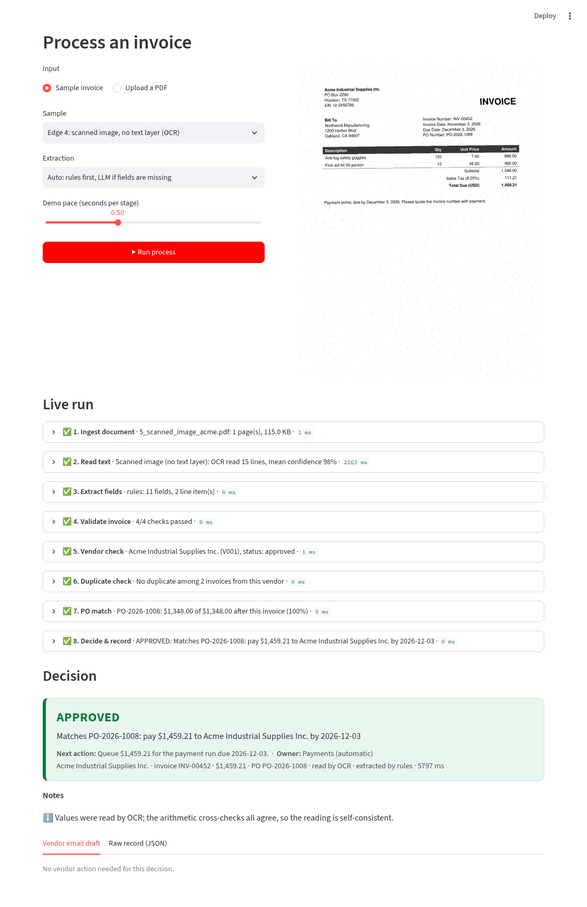

# AP Invoice Agent: from PDF to decision

An automated accounts-payable process for a mid-size company (Northwind Manufacturing).
Drop in a vendor invoice PDF and it **reads, extracts, validates, checks the vendor, catches
duplicates, matches the purchase order and decides**: `APPROVED`, `NEEDS REVIEW` or `REJECTED`.
Each decision comes with its reasons, who has to act next, and a ready-to-send email to the vendor.

Case study PS-1 (Finance / AP).



## Run it locally

```bash
pip install -r requirements.txt        # Python 3.10–3.12
streamlit run app.py                   # opens http://localhost:8501
```

Command-line version of the same pipeline (useful as a fallback during a demo):

```bash
python run.py samples/1_happy_path_delta.pdf
python run.py --reset                  # restore demo data
python -m unittest discover tests      # 13 tests: every sample reaches its intended decision
```

No API key is needed. OCR runs offline. An LLM is optional, used only as a fallback reader for
unfamiliar layouts:

```bash
export INVOICE_LLM=gemini:gemini-2.5-flash  GEMINI_API_KEY=...     # or anthropic:/openai:/groq:/ollama:
```

## The app

| Page | What it shows |
|---|---|
| **Process invoice** | Pick a sample or upload a PDF, then **Run**. The **live run view** lights up the 8 stages one by one, each expandable with its evidence. Then the decision card, reasons, owner and vendor email draft. |
| **Dashboard** ([screenshot](docs/dashboard.png)) | KPIs (processed, touchless %, held, rejected, $ approved, avg time), the exception queue with owners, full run history, and any past run opened with its complete stage log. |
| **Master data** | Vendors, purchase orders with live *invoiced / remaining* balances, the invoice register, the policy. |
| **How it works** | Process map, decision rules, edge cases. |

Use **Reset demo data** (sidebar) before a demo. The process has memory: an approved invoice uses up its PO
budget, and running the same invoice twice is correctly rejected as a duplicate.

## The process

```
PDF → 1 Ingest → 2 Read (text layer, or offline OCR if scanned) → 3 Extract (rules; LLM fallback)
    → 4 Validate (lines→subtotal→tax→total, tax rate, dates) → 5 Vendor (master, status, tax ID, bank-change fraud)
    → 6 Duplicates (exact, reformatted number, same amount) → 7 PO match (explicit or inferred; price, qty, balance)
    → 8 Decide & record → APPROVED (payment run) | NEEDS REVIEW (named owner) | REJECTED (vendor email)
```

**Design principle: AI reads, rules decide.** OCR (and optionally an LLM) handles perception. The approve,
hold or reject decision comes from explicit rules in `agent/pipeline.py` and `data/policy.json`, so every
decision can be audited and explained.

## Demo inputs (`samples/`)

| File | Scenario | Expected |
|---|---|---|
| `1_happy_path_delta.pdf` | Clean digital invoice, explicit PO, tax separated | APPROVED |
| `2a_split_invoice_ok_brightline.pdf` | **Edge 1a**: 3rd of 3 freight invoices on one PO, same amount as the previous two | APPROVED (split billing) |
| `2b_split_invoice_overbill_brightline.pdf` | **Edge 1b**: bills 2 more shipments than the PO has left | NEEDS REVIEW (over-billing, with the maths) |
| `3_duplicate_resubmitted_acme.pdf` | **Edge 2**: `417` re-sent as a "second notice"; already paid as `INV-00417` | REJECTED (duplicate) |
| `4_missing_po_coastal.pdf` | **Edge 3**: no PO number; vendor has two open POs | APPROVED with PO inferred |
| `5_scanned_image_acme.pdf` | **Edge 4**: image-only scan, slightly rotated, noisy | APPROVED via OCR, arithmetic-verified |
| `6_extra_blocked_vendor_evergreen.pdf` | Blocked vendor + "new bank details" notice | REJECTED |
| `7_extra_price_variance_coastal.pdf` | Unit price 3.9% above PO (tolerance 2%) | NEEDS REVIEW → PO buyer |

The samples are generated by `python samples/make_samples.py`, using three different vendor layouts.
Master data is in `data/*.csv`; the rules' thresholds are in `data/policy.json`.

## Deploy (free): Streamlit Community Cloud

1. Push this folder to a public GitHub repo.
2. https://share.streamlit.io → **Create app** → pick the repo, branch `main`, file `app.py`.
3. **Advanced settings → Python 3.12**. The OCR package needs Python < 3.13. `packages.txt` installs the
   system libraries OpenCV needs.
4. Deploy, then share the URL.

## Project layout

```
app.py                Streamlit UI (live run view, dashboard, master data, how it works)
run.py                CLI for the same pipeline
agent/pipeline.py     the 8 stages + decision rules
agent/extract.py      rule-based field extraction (layout- and OCR-tolerant)
agent/reader.py       PDF text layer / offline OCR (RapidOCR)
agent/llm.py          optional LLM extraction, any provider via INVOICE_LLM
agent/store.py        SQLite invoice register + run history
agent/reference.py    vendors, POs, policy
data/                 master data, invoice history, policy
samples/              demo invoices + generator
tests/                13 unit tests
docs/DESIGN.md        assumptions, decisions, limits
```
